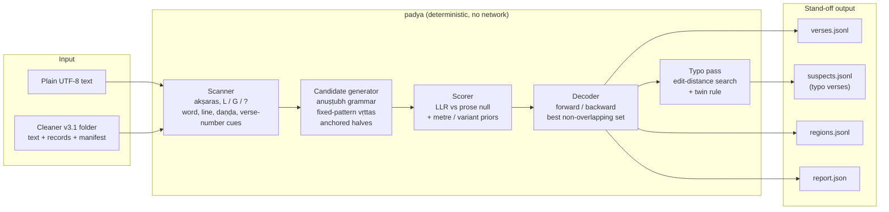
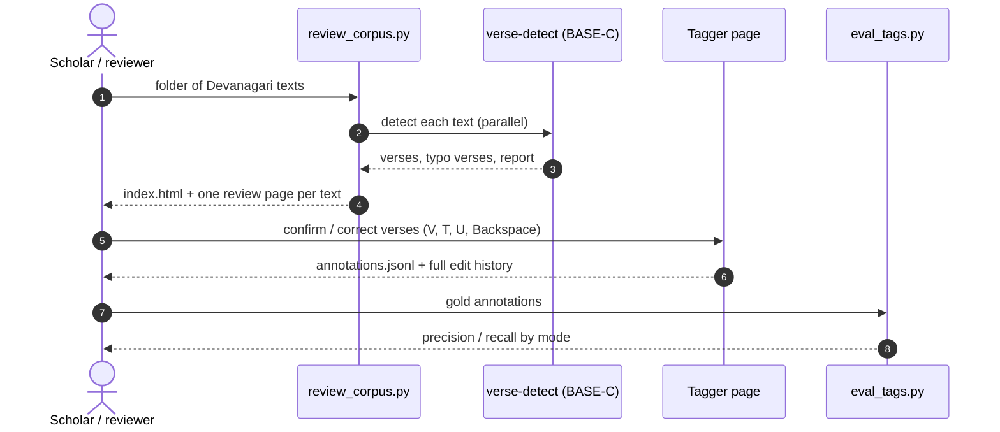
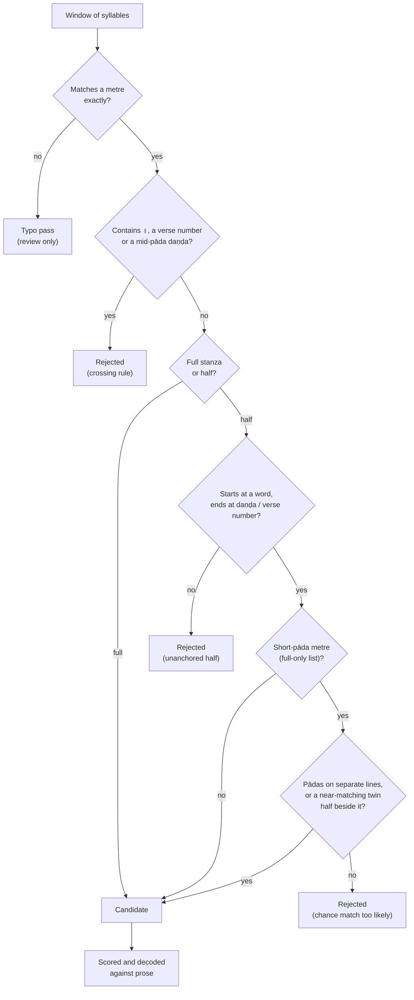

# पद्यज्ञापिनी — Sanskrit Verse Detector 🪷

[](#-status-and-roadmap)
[](pyproject.toml)
[](padya/config/profiles.yaml)
[](pyproject.toml)
[](#-tests-and-verification)
[](#-metres)
[](#-results-on-36-dharmaśāstra-digests)
[](#-design-principles)
[](https://pypi.org/project/padya/)
[](LICENSE)

A deterministic, rule-based **detector of classical Sanskrit verses (padya) inside prose (gadya)**.
It reads Devanagari text, scans every syllable as light or heavy, matches the weights against
metrical grammars and reports each verse as a **stand-off annotation**: exact code-point offsets
into the untouched source, the metre, the per-pāda variant and the evidence for the decision.
OCR-damaged stanzas are offered separately as **typo verses**, with the faulty syllables marked.

Built for the **Dharmaśāstra digests (nibandha)**: Hemādri's *Caturvargacintāmaṇi*, Lakṣmīdhara's
*Kṛtyakalpataru*, the *Smṛticandrikā*, *Nirṇayasindhu* and others, where smṛti and purāṇa verses
are quoted inside running commentary.

| | |
|---|---|
| **Specification** | [`verse_detector_blueprint_v7.md`](verse_detector_blueprint_v7.md) |
| **Package / CLI** | `padya` / `verse-detect` |
| **Current mode** | `BASE-C` · `base-c-v6` (vipulās, vṛttas, crossing rule, strict list, twin halves, editorial brackets, citation sigla) |
| **Frozen baseline** | `BASE-A` (anuṣṭubh pathyā only, kept identical for comparison) |
| **Review UI** | [`tools/tagger/verse_tagger.html`](tools/tagger/verse_tagger.html), offline, whole-book |

---

## 📑 Contents

[Architecture](#️-architecture) · [Detection rules](#-how-a-verse-is-accepted) ·
[Typo verses](#-typo-verses-ocr-near-misses) · [Metres](#-metres) ·
[Results](#-results-on-36-dharmaśāstra-digests) · [Features](#-core-features) ·
[Quick start](#-quick-start) · [Output](#-output-format) · [Tools](#️-tools-and-reports) ·
[Stack](#-technology-stack) · [Layout](#️-repository-layout) · [Tests](#-tests-and-verification) ·
[Status](#-status-and-roadmap) · [Data & license](#-data-sources-and-license)

---

## 🏛️ Architecture

### End-to-end pipeline



### From verse to review



---

## 🎯 How a verse is accepted

Every candidate must pass the grammar **and** the structural rules. Prose that happens to have a
regular rhythm is the main enemy, so each rule exists because a real false reading was found.



| Rule | Why it exists | Example it fixed |
|:---|:---|:---|
| **Crossing rule** | A window must not run over `॥` or a verse number | `अवर्षिणि … ॥ / राजा मित्रसह…` glued into one "verse" |
| **Anchored halves** | A half-verse must sit between a word start and a daṇḍa | prose labels such as `वसिष्ठः । यं न सन्तं …` |
| **Strict vṛtta list** | 11-syllable halves are too easy for prose | indravajrā / upajāti halves need strong evidence |
| **Line-split halves** | Two pādas on two lines is layout prose rarely has | `शान्ते यथाग्नौ घृतमाजुहोति / तदेव देवान्न पितॄनुपैति` |
| **Twin rule** | A clean half beside its damaged twin is a stanza | `परोऽपि बन्धुत्वमुपैति दानात् …` beside `दानेन भूता वशीभ्वन्ति …` |
| **Editorial brackets** | A short `( … )` inside a line is an editor's correction, not part of the metre; it is skipped, never removed | `यतेस्सायं (यत्र सायं) गृहस्थत्वं …` |
| **Citation sigla** | `[MDh 5․125]`, `BDhS 1․1․1․6cd` are apparatus: skipped as separators, so a śloka printed as two numbered half-sūtras still joins | `BDhS 1․1․1․6ab … / BDhS 1․1․1․6cd …` |

---

## 🩹 Typo verses (OCR near-misses)

Stanzas that fit a metre except for one or two damaged syllables are written to `suspects.jsonl`
and shown **yellow** in the tagger, with the suspect syllables underlined. They are **never**
counted as verses and the text is never corrected.

```
┌──────────────┬─────────────────────────────┬──────────────────────────────────┐
│ Edit         │ What OCR did                │ Example (observed → expected)    │
├──────────────┼─────────────────────────────┼──────────────────────────────────┤
│ substitution │ wrong vowel length / glyph  │ प्राणीवधे → प्राणिवधे                │
│ split        │ one heavy read as two light │ विकरम (lost virāma)               │
│ merge        │ two light read as one heavy │ वशीभ्वन्ति → वशीभवन्ति              │
│ missing      │ a syllable dropped          │ भूता → भूतानि                      │
│ extra        │ a syllable inserted         │ रन्तेइदेवश्च → रन्तिदेवश्च             │
└──────────────┴─────────────────────────────┴──────────────────────────────────┘
```

Budgets: ≤ 1 edit per pāda and ≤ 2 per stanza (≤ 1 per half); the twin of an accepted half may
use 2 edits in one pāda. One pāda boundary fused by visarga sandhi (`-āḥ te → -āste`) is allowed
per stanza. Typo halves of short-pāda metres are proposed only as twins.

---

## 📜 Metres

**Anuṣṭubh (śloka)**: pathyā plus na-, bha-, ma-, ra-vipulā with the caesura rules of blueprint
§5.2 (ta-vipulā blocked as epic).

**32 vṛttas**, grouped by the measured strict-list analysis
(method: `tools/strict_vrttas.py`):

| Treatment | Metres |
|:---|:---|
| ✅ **Full stanzas, halves and typo verses** | vasantatilakā · śārdūlavikrīḍita · mālinī · vaṃśastha · sragdharā · puṣpitāgrā · rathoddhatā · indravaṃśā · upajāti-12 · śikhariṇī · drutavilambita · mandākrāntā · pṛthvī · svāgatā · praharṣiṇī · dodhaka · hariṇī · toṭaka · rucirā · bhramaravilasita · mattamayūra · pañcacāmara · viyoginī |
| ⚖️ **Full stanzas; halves only with line or twin evidence** | indravajrā · upendravajrā · upajāti · upajāti 11/12 mixed (triṣṭubh–jagatī) · śālinī · vātormī · bhujagaśiśubhṛtā · bhujaṅgaprayāta · sragviṇī |
| ⛔ **Disabled** | pramāṇikā · vidyunmālā (8-syllable pādas fall inside the anuṣṭubh space) |
| 🔜 **Not yet covered** | āryā and other mātrā (jāti) metres · viṣama metres · daṇḍaka |

Each pattern agrees with at least two independent public metre lists (Vṛttaratnākara transcription,
Mishra list, Chandojñānam), except the mixed 11/12 upajāti, which no list names. All entries remain
`needs_verification` until checked against printed sources.

---

## 📊 Results on 36 Dharmaśāstra digests

Development run, mode `BASE-C` (`base-c-v6`), profile `classical_lenient`, about 39 MB of text:

```
┌──────────────────────────────────────┬──────────────────────────┐
│ Measure                              │ Value                    │
├──────────────────────────────────────┼──────────────────────────┤
│ Akṣaras scanned                      │ 5.25 M                   │
│ Verses detected                      │ 98,884                   │
│   of which half-verses               │ 21,907                   │
│ Anuṣṭubh share                       │ ≈ 98 %                   │
│ Other metres found                   │ 26 vṛttas                │
│ Typo verses (review only)            │ 7,012                    │
│ Silver ślokas recovered exactly      │ 95.1 % of 44,915         │
│ Verses containing ॥                  │ 0                        │
│ Texts failed                         │ 0 of 36                  │
└──────────────────────────────────────┴──────────────────────────┘
```

> **Development numbers, not an evaluation.** "Silver" ślokas are derived from punctuation and
> measure anuṣṭubh recall only. Precision statements come from manual spot checks; a blind gold
> set is still missing (see [Status](#-status-and-roadmap)). The corpus itself is not part of this
> repository; `verse-detect review` writes the same per-metre report for any folder of texts.

---

## 🌟 Core Features

### Detection
- **Exact offsets, zero mutation**: every emitted `text` equals `source[start:end]` (INV-1)
- **Anuṣṭubh with vipulās** and caesura checking (strict, or lenient for sandhi-fused boundaries)
- **33 metres** with full stanzas, anchored half-verses and per-pāda variants (upajāti components)
- **Probabilistic decoding**: arc posteriors from an exact forward/backward pass
- **Crossing rule, strict list, line-split and twin halves** against prose false positives

### OCR robustness
- Unknown weights (`?`) from noisy glyphs are carried, never guessed
- **Typo verses** with located suspect syllables (sub / split / merge / missing / extra)
- Cleaner v3.1 records (flags, accented spans, verse numbers) read through an attested adapter

### Review and gold annotation
- **Offline tagger** for whole books (about 1M characters): block rendering, compact autosave
- Keys `V` verse · `T` typo verse · `U` uncertain · `Backspace` remove · undo / redo / export
- Append-only edit history; export to `annotations.jsonl`, `events.jsonl`, `marked.txt`
- Detector verses pre-loaded in green, typo verses in yellow with underlined suspects
- **Adishila** for Devanagari, **Sanskrit 2003** for verses (local fonts, nothing downloaded)

### Corpus analysis
- One command reviews a whole folder: per-text pages, an index, silver recall, summary JSON
- Metre occurrence report and a measured strict-vṛtta analysis against three public metre lists

---

## 🚀 Quick start

```bash
pip install padya                      # Python 3.11+; runtime deps: pyyaml, regex

# one text or a whole folder → tagged HTML pages, index and metre report (offline)
verse-detect review book.txt --out out/book
verse-detect review path/to/texts --out out/review --jobs 4
open out/review/index.html

# stand-off JSON only
verse-detect scan book.txt --mode BASE-C --profile classical_lenient --out out/
```

From a clone: `uv venv .venv && uv pip install --python .venv/bin/python -e '.[dev]'`, then
`.venv/bin/verse-detect …` (every command below is shown that way).

<details>
<summary><b>All CLI commands</b></summary>

```bash
.venv/bin/verse-detect selftest                                    # offline checks
.venv/bin/verse-detect scan book.txt --tier T --out out/           # BASE-A baseline
.venv/bin/verse-detect run CLEANED_FOLDER --out out/               # cleaner output folder (§29)
.venv/bin/verse-detect run CLEANED_FOLDER --out out/ --strict      # unknown cleaner version = error
.venv/bin/verse-detect diagnose-offset book.txt 15 82              # inspect a span
```

`--tier` sets the OCR noise tier (`T` typeset; `unspecified` uses tier-T budgets);
`--emit-candidates` also writes every candidate arc.
</details>

<details>
<summary><b>Python API</b></summary>

```python
from padya.config import load_config
from padya.loader import load_plain_text
from padya.pipeline import detect

doc = load_plain_text("book.txt", tier="unspecified")
det = detect(doc, load_config(baseline_mode="BASE-C", profile="classical_lenient"))

for v in det.verses:                      # accepted verses
    print(v["metre_id"], v["partial"], v["text"])
for s in det.suspects:                    # typo verses, review only
    print(s["metre_id"], s["edits"], [x["text"] for x in s["suspect_syllables"]])
```
</details>

---

## 📦 Output format

| File | Content |
|:---|:---|
| `verses.jsonl` | one record per accepted verse |
| `suspects.jsonl` | typo verses (`release_decision: "ocr_suspect_review"`) |
| `regions.jsonl` | partition of the text into verse / prose / unresolved |
| `report.json` | counts, timings, active metres, `baseline_frozen_id`, release blockers |
| `candidates.jsonl` | every candidate arc (with `--emit-candidates`) |

Selected `verses.jsonl` fields:

| Field | Meaning |
|:---|:---|
| `start`, `end`, `text` | code-point offsets and the exact source slice |
| `metre_id`, `variant` | metre and per-pāda variant (`["na_vipula","pathya","pathya","pathya"]`, upajāti components) |
| `partial` | `full` or `half` |
| `lg_full` | observed scansion |
| `arc_posterior` | decoder posterior of this arc |
| `evidence`, `evidence_provenance` | score terms and where each comes from |
| `start_boundary`, `end_boundary` | boundary anchors and how they were resolved |
| `caesura_unverified_padas` | vipulā pādas whose caesura was fused by sandhi |
| `calibrated_probability` | `null` in this build (no frozen calibration yet) |

`suspects.jsonl` adds `edits`, `observed_lg`, `expected_lg` and `suspect_syllables` (offsets,
kind, pāda, syllable).

---

## 💻 Command line: one command from text to tagged pages

```bash
.venv/bin/verse-detect review TEXT_OR_FOLDER --out OUT_FOLDER            # BASE-C, classical_lenient, 3 workers
.venv/bin/verse-detect review books/ --out out/books --jobs 4 --title "Smṛti verse review"
```

Takes a UTF-8 `.txt` file or a folder (searched recursively), runs the detector and writes, under `OUT`:

| Output | What it is |
|:---|:---|
| `pages/<text>.detected.tagger.html` | one tagged page per text: verses, half-verses and typo verses highlighted, suspect syllables underlined, metre on hover; corrections can be made and exported from the page |
| `index.html` | per-text counts with links to the pages |
| `metre_report.html`, `metre_report.md` | metres covered, occurrences, anuṣṭubh variants, upajāti mixtures, per text |
| `summary.json`, `runs/<text>/…` | machine-readable counts, `verses.jsonl`, `suspects.jsonl`, `report.json` |

Everything runs offline: no network, no language model, no external scripts or stylesheets. The pages use
installed fonts only (`local()`): **Adishila** for Devanagari, **Sanskrit 2003** for verse text, and **Tiro**
fonts for every other script and for Latin/IAST (Tiro Tamil, Telugu, Kannada, Bangla, Gurmukhi; the Latin
glyphs of Tiro Devanagari Sanskrit). A machine without a font falls back to its system font for that script.
`--mode BASE-A` gives the frozen pathyā-only baseline; `--out` defaults to `<input>_review` beside the input.

---

## 🛠️ Tools and reports

| Tool | Purpose |
|:---|:---|
| `tools/review_corpus.py FOLDER --out OUT` | Detect every `.txt` in parallel; per-text review pages, `index.html`, `summary.json`, silver recall |
| `tools/build_tagger.py TEXT [--verses …]` | Build a blind or pre-filled tagger page (picks up `suspects.jsonl`) |
| `tools/eval_tags.py TEXT TAGS --mode BASE-C` | Score the detector against a tagger export |
| `tools/metre_report.py OUT --md FILE` | Metre coverage and occurrence report |
| `tools/strict_vrttas.py --sources EXT …` | Cross-check vṛtta patterns against public lists and measure chance matches in prose |
| `tools/corpus_damage_scan.py FOLDER data/impossible_clusters.txt OUT.json` | Count OCR-damage classes and impossible clusters over a corpus folder |
| `tools/fix_sigla.py FOLDER --out OUT [--dry-run]` | Restore IAST citation sigla (`[MDh 5․125]`, `ĀpDhS 1․1․1․1`) that the converter rendered as Devanagari letter garbage; mirror folder + review report (`data/sigla.tsv`) |
| `tools/silver_eval.py`, `tools/build_gold_from_typeset.py` | Punctuation-derived silver ślokas (recall-only signal) |
| `tools/verify_metres.py`, `tools/verify_spec.py` | Registry compiler, verification ledger, blueprint consistency |

---

## 🧰 Technology Stack

| Layer | Technology | Purpose |
|:---|:---|:---|
| **Language** | Python 3.11+ | Detector, tools, tests |
| **Text handling** | [`regex`](https://pypi.org/project/regex/) | Unicode grapheme and Devanagari handling |
| **Configuration** | YAML ([`pyyaml`](https://pypi.org/project/PyYAML/)) | metres, profiles, weights, frames, authorities |
| **Decoding** | exact forward/backward in log space | posteriors and best non-overlapping verse set |
| **Testing** | pytest + Hypothesis | unit, fixture, property and oracle tests |
| **Review UI** | single-file HTML + vanilla JS | offline tagging, no server, no dependencies |
| **Fonts** | Adishila, Sanskrit 2003, Tiro (local only) | Devanagari, verse text, other scripts and Latin |

---

## 🗂️ Repository layout

```
padya/                   the detector (no LLM, no network)
├── scanner.py           akṣara stream, weights, cues
├── candidates.py        grammar windows, half anchors, crossing rule, strict list
├── metres/              anuṣṭubh grammar, fixed-pattern gate, registry compiler, bit masks
├── scorer.py            LLR scoring        ·  decoder.py   forward / backward decoding
├── ocr_suspects.py      typo verses        ·  twins.py     twin rule for one-line halves
├── pipeline.py          orchestration      ·  writer.py, annotate.py, regions.py   output
└── config/              metres.yaml, profiles.yaml, weights.yaml, frames.yaml, …
tools/                   tagger, corpus review, reports, verification
tests/                   670 tests: unit, fixtures, properties, decoder oracle
data/metres/             metre verification ledger
data/sigla.tsv           citation sigla table for tools/fix_sigla.py
data/impossible_clusters.txt   consonant clusters that cannot occur in Sanskrit (OCR-damage scan)
verse_detector_blueprint_v7.md   the specification
CONTRIBUTING.md          the rules every change must follow
```

---

## ✅ Tests and verification

```bash
.venv/bin/pytest -q                         # 670 passed
.venv/bin/python tools/verify_metres.py     # registry + verification ledger
```

The suite includes real OCR-damaged stanzas reported during review (for example
`ये क्षान्तदान्ताः …`, `दानेन भूता वशीभ्वन्ति …`), prose controls that must not match, decoder
oracle comparisons, Hypothesis property tests on offsets and partitions, and a guard that `BASE-A`
stays frozen.

**Results (2026-10-18):**

| Check | Result |
|:---|:---|
| pytest | **670 passed**, 24 skipped (~15 s) |
| Silver recall, 36 digests | 95.06% of punctuation-derived anuṣṭubh ślokas (recall only, not precision) |
| Skrutable 2.9.3, 414 sampled full stanzas | **414 / 414** metre labels agree, vipulā names included |
| Chandojñānam, 565 sampled verses per pāda | 461 verses agree on every pāda; 103 more agree except vipulā pādas it has no rule for; 1 syllabification difference where padya is right; **0 real disagreements** |

The cross-check confirms labels, not detection: prose false positives are measured separately with
`tools/strict_vrttas.py` (expected chance matches of each pattern in prose).

---

## 🧭 Design principles

1. **Annotate, never edit.** Source text is never normalised or corrected; offsets are stand-off.
2. **Deterministic.** Same input, config and version give the same output; no LLM, no network.
3. **Fail closed.** Unknown metres, unverified grammars and offset mismatches are errors.
4. **Prefer abstention.** Ambiguous evidence becomes an uncertain region or a typo verse.
5. **Measure before widening.** New metres or looser rules need a measured chance-match rate in
   prose and a reviewed sample of what they recover.
6. **One source of truth for numbers.** Tunables in `weights.yaml`, switches in `profiles.yaml`.

---

## 🧪 Status and roadmap

**Developer alpha.** Release blockers reported in every `report.json`:

| Blocker | Meaning |
|:---|:---|
| `unverified_enabled_grammar` | no metre has a recorded primary-source verification yet |
| `missing_gold_negative_denominator` | no blind gold prose sample, so false-positive rates are estimates |
| `no_frozen_threshold` | `calibrated_probability` stays `null` |
| `cleaner_contract_unverified` | plain-text input only (cleared for cleaner v3.1 output) |

**Next:** a blind gold sample for precision · primary-source verification of each metre ·
mātrā metres (āryā family) · verses joined to a following `इति` (`…निराकृतिरिति ॥`) ·
BASE-B cue and frame scoring.

---

## 📄 Data, sources and license

**Code:** [MIT License](LICENSE).

**Corpus text is not part of this repository.** The Dharmaśāstra texts the detector was developed
on are not redistributed here; short verse quotations in tests and documentation are included only
for testing and illustration. The detector works on any UTF-8 Devanagari text you supply.

**Metre lists used for cross-checking** (read from local clones, not included): the
Vṛttaratnākara transcription by Dhaval Patel and the Mishra/Heidelberg list via
[shreevatsa/sanskrit](https://github.com/shreevatsa/sanskrit) ·
[Chandojñānam](https://github.com/hrishikeshrt/chandojnanam) (IIT Kanpur) ·
[vidyut-chandas](https://github.com/ambuda-org/vidyut/tree/main/vidyut-chandas) (Ambuda).

<sub>पद्यज्ञापिनी · © 2026 Neelakantha Shastri, <a href="https://github.com/vsparishad">Vaidika Samrakshana Parishad</a> · MIT</sub>
